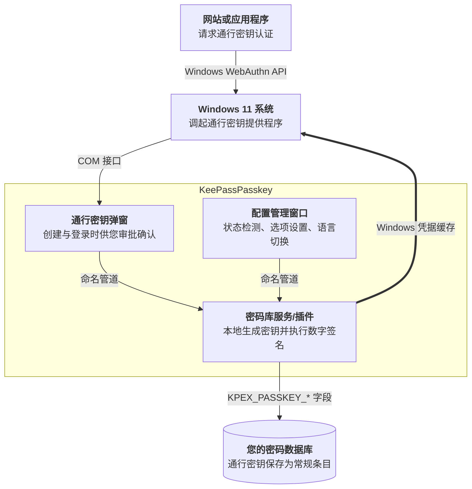

# KeePassPasskey

[](https://github.com/yusei36/KeePassPasskey) [](https://github.com/yusei36/KeePassPasskey/releases/latest) [](https://github.com/yusei36/KeePassPasskey/releases/latest) [](https://apps.microsoft.com/detail/9nwnfhjpspgz?mode=direct)

**[快速安装](#快速开始--新电脑一键安装推荐)** | **[安装方式](#其他安装方式)** | **[使用指南 (英文)](docs/user-guide.md)** | **[常见问题与排错 (英文)](docs/troubleshooting-faq.md)**

一个将 KeePass 与 KeePassXC 转变为 Windows 11 原生通行密钥（Passkey）提供程序的工具。支持通行密钥的网站和应用程序均可自动接管与调用，无需安装任何浏览器扩展插件。


> [!TIP]
> **本分支强化特性：**
> - 🇨🇳 **原生中文界面**：全界面 100% 深度中文本地化，跟随系统语言自适应匹配，支持中英文即时无缝切换。
> - ⚡ **免 PIN 极速认证**：默认提供通知/免输入 Windows PIN 码验证模式，可自由选择验证级别，彻底摆脱频繁输入系统密码的繁琐困扰。
> - 🧩 **KeePassXC 原生支持**：完美适配原生集成 Windows Passkey 服务的 KeePassXC，自动回退解析真实数据库文件名，无需额外放置插件 DLL。
> - 📦 **一键全自动打包安装**：针对新电脑提供开箱即用打包方案，双击批处理全自动导入信任证书并完成系统组件注册。

---

## 🚀 快速开始 / 新电脑一键安装（推荐）

针对新电脑或全新 Windows 11 环境，推荐直接使用打包好的开箱即用套件：

### 1. 运行与配置 KeePassXC（便携版）
1. 解压带有 Windows Passkey 服务支持的 KeePassXC 便携版（例如解压至 `C:\Tools\KeePassXC` 或任意常用目录）。
2. 打开 `KeePassXC.exe`，解锁或新建您的 `.kdbx` 密码数据库。
3. 进入菜单【工具】 -> 【设置】 -> 【通行密钥 (Passkeys)】：
   - 勾选【启用通行密钥】；
   - 勾选【允许来自 WindowsPasskey 服务的外部连接】；
   - 验证模式：默认为“通知模式（免输 Windows PIN 码）”。

### 2. 一键安装 KeePassPasskey
1. 解压 `KeePassPasskey-v1.5.1-Windows11-x64.zip`。
2. 双击运行 **`一键安装(双击运行).bat`**（弹出 UAC 提权提示时点击【是】）。
3. 脚本将自动完成：将自签名证书导入系统受信任证书库、安装 MSIX 应用程序、初始化注册凭据提供程序，并在最后自动调出 Windows 11 设置窗口。

### 3. 在 Windows 11 系统设置中启用
- 在自动弹出的 Windows 11 系统设置页面【附加提供程序】中，将 **【KeePassPasskey】** 开关设置为 **【开】**。
- *(若未自动打开，可手动前往：Windows 设置 -> 系统 -> 凭据与密码 -> 通行密钥 -> 附加提供程序)*。

**完成！** 以后使用 Chrome、Edge 或 Firefox 访问任何支持 Passkey 的网站（例如 [webauthn.io](https://webauthn.io/)），系统都会直接调起 KeePassPasskey 弹窗，将密钥直接存入您的本地数据库。

---

## 系统要求

- [KeePass](https://keepass.info/) 2.54 或更高版本，或原生支持 Windows Passkey 服务的 [KeePassXC](https://keepassxc.org/)
- Windows 11 24H2 或更高版本（内部版本 26100 及以上），且已启用 TPM[*](docs/troubleshooting-faq.md#why-is-a-tpm-required) 并配置了 Windows Hello[*](docs/troubleshooting-faq.md#why-is-windows-hello-required)

**当前局限：**
- 不支持企业证明（Enterprise Attestation，受限于架构不可行，详见[局限说明](docs/user-guide.md#limitations)）
- 暂未支持 PRF（计划中，参见 [Issue #24](https://github.com/yusei36/KeePassPasskey/issues/24)）

## 工作原理

当网站请求通行密钥时，Windows 11 会提供 KeePassPasskey 作为凭据提供程序。您在提示框中确认请求后，通行密钥便会在已解锁的数据库中创建为一条普通条目。若数据库处于锁定状态，应用会先提示您解锁。登录时走相同的逻辑，直接读取已有条目。密钥永远不会离开您的本地数据库文件，所有加密计算完全在本地执行。

<details>
<summary><b>架构流程图：通行密钥请求的流转路径</b></summary>



</details>

您会通过两种形式与 KeePassPasskey 交互：
1. **操作提示弹窗**：在网站发起创建或登录请求时弹出，供您确认批准；
2. **主程序窗口**：随时手动打开，用于查看运行状态、调整通知/免 PIN 设置或管理插件。

两者属于同一个已安装的应用，仅以不同的启动参数调起，且闲置时会自动退出，不会常驻后台占用内存。

为了使 Windows 能在系统登录对话框与自动填充中直接列出您的通行密钥，在打开或保存数据库时，通行密钥的元数据（网站地址和用户名，绝不包含私钥本身）会被同步写入 Windows 凭据缓存。

条目采用与 KeePassXC 完全兼容的 `KPEX_PASSKEY_*` 扩展字段，因此 KeePass 与 KeePassXC 之间可以无缝互相读取。

在底层，Windows 11 将通行密钥操作路由给一个注册为插件身份验证器的 COM 服务。本项目涵盖了该机制的完整实现：
- **KeePassPasskeyProvider.exe**：MSIX 打包的凭据提供程序。Windows 在收到请求时冷启动它，闲置时自动退出；同时它也负责提供前台配置界面及同步 Windows 凭据缓存。
- **KeePassPasskey.dll / 原生服务端**：用于生成、签名和存储密钥的 KeePass 插件或 KeePassXC 内置服务。

---

## 其他安装方式

除了上方的【一键安装推荐方案】外，还支持以下原生安装方式：

### 方式 A - 微软商店安装（原版发布通道）

[](https://apps.microsoft.com/detail/9nwnfhjpspgz?mode=direct)

1. 从微软商店安装 [KeePassPasskey](https://apps.microsoft.com/detail/9nwnfhjpspgz) 并启动。
2. 按照内置的**配置向导**操作：点击**安装插件**，确认检测到的 KeePass 目录，点击**安装**（若 KeePass 正在运行请重启它）。如果喜欢手动复制，应用也可以直接在资源管理器中打开插件所在位置。
3. 继续跟随向导打开 Windows **附加通行密钥选项** 并启用 **KeePassPasskey**。
4. **KeePassPasskey** 应用中的两项状态指示灯应均显示为绿色。


> [!NOTE]
> 商店应用会自动静默更新，而 KeePass 插件不会。当应用更新到新版本后，KeePass 会在下次启动时提示更新插件，详见[更新说明](docs/user-guide.md#updates)。

喜欢命令行？也可使用 winget 直接安装：
```powershell
winget install 9NWNFHJPSPGZ --source msstore
# 或通过名称安装：
winget install --name "KeePassPasskey" --source msstore
```

### 方式 B - GitHub Release 脚本安装

1. 从 [Releases 页面](https://github.com/yusei36/KeePassPasskey/releases) 下载 `KeePassPasskey-<version>.zip` 并解压。
2. 右键以管理员身份运行 `InstallMsix.bat`，它会自动信任随附的证书、安装 MSIX 包并启动 **KeePassPasskey** 提供程序应用。
3. 在应用中点击**安装插件**，确认 KeePass 目录并安装，然后重启 KeePass。
4. 在应用中点击 **Windows 通行密钥设置** 并将 **KeePassPasskey** 设为启用。
5. 两个状态指示灯均变为绿色即表示就绪。

### 方式 C - GitHub 手动分步安装

1. 下载并解压发布包。
2. 信任证书：右键点击 `KeePassPasskey.cer` → **安装证书** → **本地计算机** → 存储位置选择**受信任人 (Trusted People)**。
3. 安装 MSIX：双击 `KeePassPasskeyProvider.Package_<version>_x64.msix` 并点击**安装**。
4. 从开始菜单启动 **KeePassPasskey**，安装插件并重启 KeePass。
5. 点击**通行密钥高级设置**，启用 **KeePassPasskey**。
6. 两项状态指示灯均显示绿色。
7. （可选）移除证书：打开 `certlm.msc` → **受信任人** → **证书**，找到 **KeePassPasskey** 并删除（证书仅在 MSIX 安装阶段需要验证）。

---

## 凭据存储格式

通行密钥以标准 KeePass 条目形式保存，完全兼容 [KeePassXC 通行密钥字段规范](https://github.com/keepassxreboot/keepassxc)：

| 字段名 | 内容说明 |
|---|---|
| `KPEX_PASSKEY_CREDENTIAL_ID` | Base64url 格式的凭据 ID |
| `KPEX_PASSKEY_PRIVATE_KEY_PEM` | PKCS#8 私钥（PEM 格式） |
| `KPEX_PASSKEY_RELYING_PARTY` | 依赖方标识符（例如 `github.com`） |
| `KPEX_PASSKEY_USERNAME` | 注册时关联的用户名 |
| `KPEX_PASSKEY_USER_HANDLE` | Base64url 格式的用户句柄 (User Handle) |
| `KPEX_PASSKEY_FLAG_BE` | 可备份资格标志 Backup Eligibility（`1`/`0`，默认为 `1`） |
| `KPEX_PASSKEY_FLAG_BS` | 当前备份状态标志 Backup State（`1`/`0`，默认为 `1`） |

此处创建的凭据可以被 KeePassXC 直接读取，反之亦然。支持三种加密算法：**ES256** (EC P-256)、**EdDSA** (Ed25519) 以及 **RS256** (RSA-2048)。算法类型直接编码在 PKCS#8 OID 中，不需要单独的字段，与 KeePassXC 的存储格式 100% 一致。

`FLAG_BE` 与 `FLAG_BS` 对应 WebAuthn `authenticatorData` 标志字节的第 3 位和第 4 位。`BE=1` 表示该凭据允许跨设备备份与同步；`BS=1` 表示当前已经处于备份状态。两者默认均为 `1`，与 KeePassXC 的行为保持一致。新密钥的默认值可在设置中配置，也可在条目级别覆盖，详见[专家设置说明](docs/user-guide.md#expert)。

---

## 安全性

- **私钥不出库**：所有签名操作均在 KeePass 或 KeePassXC 内部进行，私钥绝不会通过管道传输。在 KeePass 中，私钥受到内存保护，仅在执行签名瞬间进行解密，详见[私钥是如何保护的？](docs/troubleshooting-faq.md#how-is-the-private-key-protected)。
- **调用方身份校验**：插件在处理任何请求前均会验证发起连接的 COM 服务包标识（Package Family Name），拒绝非正规 MSIX 进程的调用。
- **严格管道访问控制**：命名管道采用中等完整性级别的当前用户 ACL 访问控制列表进行防护，其他用户或低完整性进程无法建立连接。

---

## AAGUID

AAGUID 用于向依赖方网站标识创建通行密钥的验证器身份。KeePassPasskey 的官方 AAGUID 为：

`9addb28c-b46f-4402-808f-019651441ff3`

---

## 项目工程结构

```
src/
  KeePassPasskeyShared/            进程间通信 (IPC) 协议定义与共享工具库
  KeePassPasskeyProvider/          COM 凭据提供程序服务与 Avalonia 客户端 (.NET 10, x64)
  KeePassPasskeyPlugin/            KeePass 插件 (.NET Framework 4.8)
  KeePassPasskeyPlugin.Tests/      单元测试 (xunit.v3)
  KeePassPasskeyProvider.Package/  MSIX 打包工程 (wapproj)
scripts/
  Install-Provider.ps1             构建、签名并安装用于本地调试的 Provider（需管理员权限）
  Publish-Package.ps1              构建 Release、签名并生成可分发的完整 zip 包
  InstallMsix.bat                  终端用户 MSIX 安装批处理脚本（随发布包分发）
```

---

## 编译构建指南

### 环境依赖

| 依赖项 | 说明 |
|---|---|
| Visual Studio 2026 | 需安装“.NET 桌面开发”工作负荷 |
| Windows SDK 10.0.26100.7175+ | wapproj 构建和代码签名所需 |
| .NET 10 SDK (10.0.400) | 用于编译 KeePassPasskeyProvider |
| .NET Framework 4.8 SDK | 用于编译 KeePassPasskeyPlugin |
| KeePass.exe (2.54 引用版本) | 放置于 `build\KeePass.exe` - 最低支持版本，仅用于编译引用 |
| KeePass.exe (当前运行版本) | 放置于 `build\KeePass\KeePass.exe` - 本地调试运行时调起的 KeePass |

```powershell
# 编译期引用 - KeePass 2.54 (最低支持版本)
Copy-Item "path\to\KeePass-2.54\KeePass.exe" build\

# 调试与运行目标 - 您当前安装的 KeePass
Copy-Item "C:\Program Files\KeePass Password Safe 2\KeePass.exe" build\KeePass\
```

以管理员身份运行构建脚本（执行 MSIX 打包、数字签名并完成本地安装）：

```powershell
.\scripts\Install-Provider.ps1 -Configuration Release
```

将 `build\Release\` 中的 DLL 复制到 KeePass 的 `Plugins\KeePassPasskeyPlugin\` 目录中并重启 KeePass。然后在应用中点击 **Windows 通行密钥设置** 并启用 **KeePassPasskey**。

### 运行测试

```powershell
dotnet test --project src/KeePassPasskeyPlugin.Tests/KeePassPasskeyPlugin.Tests.csproj
```

### 手动注册（CLI 命令行方式）

如果自动注册未生效，可使用命令行手动完成：

```powershell
KeePassPasskeyProvider.exe /register
KeePassPasskeyProvider.exe /status   # 验证注册状态
```

随后打开 Windows 设置：**设置 → 账户 → 通行密钥 → 高级选项** → 将 **KeePassPasskey** 开关切换为开启。

---

## 开源许可证

Copyright © 2026 Uwe Kögel

本项目采用 **GNU General Public License v3.0 (GPL-3.0)** 许可证开源。详见 [LICENSE](LICENSE) 文件。
